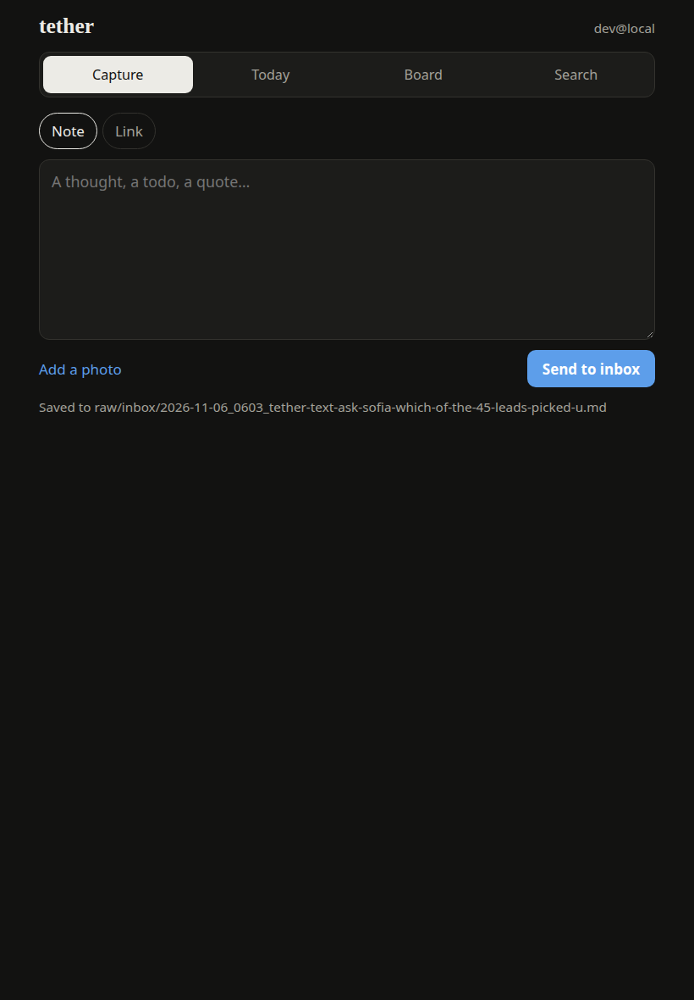

# tether

An iPad companion for my Linux laptop. One Go binary joins my tailnet with Tailscale's `tsnet`
(no open ports, no passwords: Tailscale says who is connecting) and serves a small installable web
app for capturing things into my [second brain](https://github.com/Kage7047) and reading it.

- **Capture:** a note, a link or a photo, written into `raw/inbox/` as a new markdown file for
  `/learn` to file later. If the laptop is asleep, captures wait on the iPad and send themselves
  when it is back.
- **Read:** today's daily note, the project board, any wiki page.
- **Search:** the vault's own BM25 search (`tools/search.py`), results open as pages.



## Security

The vault is private, so tether is built around [a threat model](docs/THREAT_MODEL.md): tailnet
only, an allowlist of logins checked with WhoIs on every request, CSRF protection, page reads
confined to `wiki/` (symlinks included), new files only, argv-only search, sanitised markdown, a
CSP, and a systemd unit that leaves the rest of the disk read-only. Each defence has a test.

## Run it

```bash
cd web && npm ci && npm run build && cd ..      # the app, embedded into the binary
go build -o ~/.local/bin/tether ./cmd/tether
tether -dev -vault ~/second-brain                # http://127.0.0.1:8787, no tailnet
tether -vault ~/second-brain -allow you@github   # on the tailnet; first run prints a login URL
```

For the installable app, enable HTTPS certificates in the Tailscale admin console; tether then
serves `https://tether.<tailnet>.ts.net`. Open it in Safari on the iPad and use Share → Add to
Home Screen. To keep it running: `deploy/tether.service`.

## Roadmap

- [x] v0.1 capture, read, search
- [ ] v0.2 watch and steer: systemd units and CI status, push alerts, an allowlist of commands
  with confirmation and an audit log
- [ ] v0.3 second screen with Apple Pencil (a spike first: X11 virtual monitor + WebRTC)

## License

MIT
